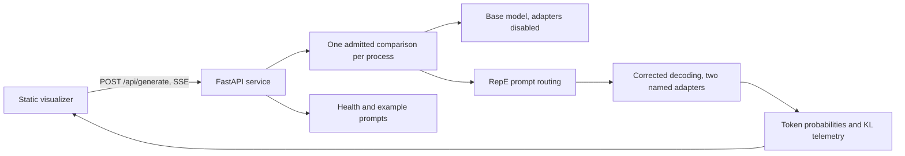

# Multi-UnLoRA: POC to a dependable live demo

Prepared 9 November 2026. This delivery plan complements, and does not replace,
`Multi_Unlora_MASTER_BLUEPRINT.md`. That document's literature, novelty, and
publication claims remain unvalidated. Building an observable demo does not
establish those claims.

## Outcome

A visitor enters a prompt or chooses a preset, runs a comparison, and watches
the base model and Multi-UnLoRA respond. The interface explains routing and
token correction with measured telemetry, exposes failures, and clearly
distinguishes an illustrative preview from actual model inference.

## Architecture and ownership

Use one same-origin deployment when possible: Modal serves the web directory
and the API together. A separately hosted static Site can connect to an HTTPS
API through the connection settings; allow only that Site's origin in CORS.
The browser must never hold a provider credential. An optional demo bearer
token is a visitor access credential, entered for the current session only.

The backend, frontend, and inference hardening work are delegated independently
with an agreed event contract. Integration, documentation, dependency locking,
and final verification belong to the primary agent.

## Delivery stages and acceptance gates

| Stage | Work | Gate |
| --- | --- | --- |
| 1. Establish correctness | Restore adapter state on exceptions; stable KL; zero-strength identity; normalize router vectors safely; identical evaluation prompts | CPU regression tests; old benchmark CSVs marked incompatible |
| 2. Serve the model | Validated FastAPI request; lazy GPU loading; SSE; bounded admission; cancellation; health; optional bearer auth and explicit CORS | CPU API tests including invalid input, unavailable backend, concurrency and error paths |
| 3. Visualize | Prompt examples; streamed comparison; router weights; token distribution; latency; stop; connection and error states; responsive layout | JS checks and browser checks where available |
| 4. Prepare deployment | Local run command; separate Modal deployment entry point; static Site package; reproducible dependencies and CI | Tests pass; frontend loads; GPU smoke test recorded separately |
| 5. Validate live compute | Verify trained adapters and RepE checkpoint; deploy GPU service; cold and warm prompt runs; cancellation under load | Both branches produce real model output, telemetry finite, subsequent requests recover after interruption |
| 6. Validate research | Related-work gate G0; contrastive operator experiment; anti-expert quality; detector distribution; unbiased benchmark reruns | Recorded experiment artifacts, seeds, uncertainty, external judging; no claims based on preview data |

Stages 1–4 are implementation scope for this pass. Stage 5 requires an
authenticated Modal account, usable trained artifacts, and GPU execution;
it is a separate deployment/validation gate, not something a CPU test proves.
Stage 6 is the research programme in the existing blueprint. In particular,
its replacement operator, arbitration, certificate, multi-family experiments,
and benchmark construction must not be silently presented as implemented by
hardening the current experimental processor.

## Live deployment runbook

1. Run the CPU tests and the explicit local preview described in README.
2. Confirm both adapter directories contain compatible weights and the RepE
   checkpoint exists on `multi-unlora-vol`. The demo must not train or calibrate
   implicitly when receiving a visitor request.
3. Authenticate Modal, review `modal_demo.py`, and deploy it. Start with one
   GPU container, one active comparison, and the configured request/token limits.
4. Open its same-origin website. Confirm `/api/health` reports GPU backend;
   run one benign prompt, one false-premise prompt, and one safety preset.
5. Verify the same rendered prompt is used for both arms, stop a generation,
   immediately submit another, and confirm adapter state remains clean.
6. If using the static Site, set its API URL and add its exact origin to the
   backend's allowed origins. Do not put private Modal/provider secrets in JS.
7. Record measured cold-start time, generation throughput, peak GPU memory,
   and failures. Set operational limits based on measurements before opening
   the service to unrestricted public traffic.

## Remaining project work, in priority order

- **Scientific correctness:** implement and compare the blueprint's contrastive
  operator separately; measure anti-expert quality and router calibration;
  replace asymmetric historical results rather than appending to them.
- **Evaluation validity:** independent judge and refusal rubric; held-out
  operating-point selection; over-refusal set; paired uncertainty intervals;
  multiple training seeds and model families.
- **Performance:** separate KV caches per adapter with cached/uncached equivalence
  tests. The first real serving version intentionally uses full-prefix passes
  to avoid adapter cache contamination; throughput must be measured.
- **Reproducibility:** artifact manifests binding model revision, adapter hashes,
  vector provenance, training data revisions and settings. Training resumption
  should validate artifact completeness rather than just directory presence.
- **Operations:** sustained GPU load tests, proxy-level per-user quotas,
  deployment-level authentication, cost monitoring, and an artifact rollback
  procedure before a broad public launch.

## Definition of done

The implemented demo is complete when CPU contract checks pass and the website
can consume the real inference protocol. A *validated live model deployment*
additionally requires Stage 5 evidence. A *research-ready project* requires
Stage 6. Report these outcomes separately; never substitute canned answers,
simulated telemetry, or a published static page for validated live inference.
