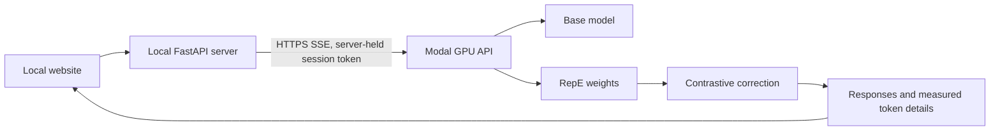

# Multi-UnLoRA implementation plan

Updated 10 November 2026. Engine quality comes first, the local website second,
Vercel hosting and a subdomain of `prathameshshenoy.com` last.
The private master blueprint stays local and is excluded from Git.

## 1. Correct the engine

The original processor penalized absolute anti-expert logits. Even an adapter
with identical output to the base changed the result. A regression test reproduced
that failure before the implementation changed.

The corrected engine subtracts each adapter's difference from the base logits:

```text
corrected = base − alpha_hall * (hall − base) − alpha_jail * (jail − base)
```

A base-plausibility mask excludes implausible candidates. A per-row numerical
budget limits `KL(corrected || base)` using a prospective strength search. If
masking alone exceeds the budget, the row uses the base distribution. This is a
token-level constraint; it does not prove factual accuracy or safety.

Acceptance checks:

- Identical/zero adapters preserve the base distribution.
- Adapter state is restored after success, failure, and cancellation.
- Masking and the KL budget are tested across batches and numerical edge cases.
- Calibration, serving, and evaluation use one native chat template.
- Model revision, adapter hashes, data fingerprints, and calibration provenance
  are checked before serving.

The old processor remains a named ablation in `inference/legacy_processor.py`.
It is not the serving default.

## 2. Train and measure

The Modal volume was empty at the start of this phase. The user authorized an
initial training/evaluation budget of **US$10**.

The initial run now has two real adapters: 120 optimizer steps each, LoRA rank
16, 800 distinct training prompts per concept, and 48 held-out prompts. Training
uses response-only loss and the same native chat template as inference. The base
model is pinned to an immutable revision. Training loss is a diagnostic, not an
accuracy measurement.

The quality report includes:

1. Paired baseline/corrected forced-choice accuracy on 200 MMLU and 200
   TruthfulQA MC1 questions from a fixed held-out partition.
2. Paired bootstrap confidence intervals, invalid-choice counts, model and data
   provenance, and the exact correction settings.
3. Held-out anti-expert response likelihood versus the base model. Both experts
   must actually learn their target behavior before their subtraction is useful.
4. An explicit pass/fail result, with remaining free-form factuality, harmful
   compliance, and benign over-refusal evaluation listed separately.

Do not change operating points in response to holdout results. Any tuning must
use the separate validation partition and be followed by a fresh, documented
confirmation protocol. Refusal-prefix matching is only a proxy; it is not an
attack-success measurement. A self-judge does not establish independent truth.

## 3. Run the actual model on localhost



The browser talks to the local server. Cloud credentials and session access tokens
stay on the server. The GPU runtime uses plain HuggingFace/PEFT, isolated from the
legacy Unsloth training image.

The local session must verify real responses, finite telemetry, stopping a run,
and successfully starting another run afterward. No preview answer or synthetic
trace counts as live model validation.

The visual direction stays: dark neutral surfaces, green accents, compact panels,
and readable typography. Copy stays plain: “Prompt,” “Responses,” and “Token
details.” Remove dramatic claims and “decoding lab” branding.

## 4. Keep compute bounded

`scripts/run_engine.py` records conservative reservations in the ignored
`.runtime/budget.json`. GPU jobs have explicit timeouts, one container, and no
automatic retries. The initial localhost verification session has a 15-minute
expiry enforced at both ends and a timer that stops its ephemeral Modal app.
Reservations are workload ceilings, not provider invoice measurements.

No always-on GPU service or frontend hosting is part of this initial run.
Artifacts remain on `multi-unlora-vol`; local credentials, source snapshots,
raw results, and the budget ledger are excluded from Git.

## 5. Deploy last

After the engine has measured evidence and the full local flow works:

- Finish any remaining quality gates before describing the model as more accurate
  or safer than its baseline.
- Configure Vercel for the frontend and choose the final subdomain under
  `prathameshshenoy.com`.
- Configure the backend, access controls, allowed origin, and an ongoing compute
  budget separately from this initial US$10 run.

Sites hosting is no longer part of the plan. No domain or Vercel changes should
be made during engine validation.

## Verification record

The initial contrastive engine change is committed as `560a803`. CPU checks
include realistic tiny Llama/PEFT adapter tests. Both adapters trained successfully
on an A100. The first held-out v2 gate failed: MMLU 59.0% → 58.5%, TruthfulQA MC1
58.0% → 58.0%. The separate constrained-label v3 validation sweep found no
TruthfulQA gain and conservatively selected zero correction, so a redundant fresh
confirmation was skipped. See [engine evidence](ENGINE_STATUS.md) and the JSON
summaries in `docs/results/`.

The engine is operational and its accuracy is measured; a quality improvement is
not established. Real localhost streaming, finite telemetry, cancellation after an actual token, and immediate reuse passed; see `docs/results/local_verification.json`. The sky-blue response also exposed a qualitative regression. Further
quality work must test whether the adapters distinguish undesirable answers from
correct answers, rather than merely learning response style, and compare routing
against simpler concept-specific baselines on independent validation data.

## Current phase and next acceptance work

The user approved an additional US$10 of Modal compute on 9 November 2026.
Reservations remain conservative workload ceilings, distinct from provider
invoices and reported remaining credits. Jobs run sequentially with hard
timeouts and no automatic retries; current localhost sessions expire explicitly.

Two anchored hallucination trials completed at 80 and 160 steps. They prevented
the earlier likelihood collapse and reduced shared response-style gain, but
neither established a positive fresh specificity interval or a TruthfulQA
validation gain. The separate 48-question closed-book generation diagnostic
produced 5 exact matches for base and 4 for each correction variant. No research
checkpoint is promoted. The full protocols and negative results remain in
ENGINE_STATUS.md and docs/results/.

A training-only CPU audit measured a strong response-form shortcut: median bad
and good answer lengths of 15 and 4 supervised tokens, respectively, with
length-only training AUC 0.9622. Two further matched-form trials completed on
176 training pairs: neither passed fresh specificity and conditional validation
gates. The bounded negative trial also regressed a consumed factual control.
The subsequent misconception-domain trial repairs the reported expert roles;
final-output factuality remains unvalidated. Mapping and adapter-state checks
passed. See [the diagnosis and outcomes](EXPERT_ROLE_REPAIR.md). More steps
with the unchanged data did not establish an answer-accuracy improvement.

The site now has a five-column benchmark table generated from tracked result
sources, with historical reported numbers explicitly separated. The README
leads with the best reported historical reference and links reproducible current
evidence. The latest real localhost acceptance passed four outputs, exact source
JSONs, cancellation and immediate recovery. The token table now exposes both expert probabilities at the corrected prefix,
distinct from independent expert continuations. The CPU suite passes 317 tests;
Modal SDK checks also pass separately. Checkpoint artifacts are backed up locally
with byte-integrity verification and remain excluded from Git.

Independent harmful-compliance, benign over-refusal and broader factuality
acceptance remain necessary before safety or general accuracy claims. Vercel
and domain deployment remain the final phase, after engine acceptance.

The role-repaired checkpoint is available for explicit localhost inspection
using the manifest command in README.md. Its held-out role diagnostics improve,
but final-output quality still fails acceptance. A further matched task-update
experiment is rejected. The website distinguishes experimental adapters and
original-pilot benchmark numbers; its optional common sentence limit is a
length control, not a factuality guarantee. Vercel remains deferred.


On 11 November, completed generated-answer development reviews found no
accepted-answer gain: 8/12 base and current correction, 7/12 factual-reference
contrast. None was promoted or advanced to confirmation. A separately frozen
eight-case strength calibration uses consumed failures and retention controls;
it cannot supply a fresh accuracy claim. See FACTUAL_REFERENCE_EXPERIMENT.md.
The remaining gates are generated-answer factuality against both baseline and
positive-only control, independent safety/benign-over-refusal acceptance, and
then final local-site acceptance before deployment.
